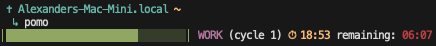

# pomo

A terminal Pomodoro timer written in Swift.

## Features

- Customizable work/break durations
- Multiple work cycles with break intervals
- Long break command for extended rest periods
- Session statistics and historical tracking
- Runs inside [herdr](https://github.com/ogilvieherdr/herdr) with notification support
- Falls back to terminal bell when not in herdr
- ANSI-colored countdown display
- Custom notification sound (MP3, WAV, AAC, FLAC, and more)
- Pause/resume timer with 'p' key
- Persistent configuration in ~/.config/pomo/config.json



## Usage

```bash
# Default 25-minute work session
pomo

# Custom duration (minutes)
pomo -d 15

# Multiple work cycles with breaks
pomo -c 3 -b 3

# Custom notification sound (any afplay-supported format)
pomo -s /path/to/chime.wav

# Multiple cycles with custom sound
pomo -c 3 -s ~/Sounds/pomo.mp3

# Pause/resume: press 'p' during any segment
# Skip to next segment: press 'c' during any segment

# Long break (10 minutes by default)
pomo break

# Custom duration long break
pomo break -d 15

# View statistics
pomo stats
pomo stats --week
pomo stats --month
pomo stats --year
```

## Timer Controls

- **p / P** — Pause or resume the timer
- **c / C** — Skip to the next segment (or completion)

When paused, the timer shows a "PAUSED" indicator and the remaining time freezes. Press 'p' again to resume.

## Statistics

Track your Pomodoro usage over time. Sessions are automatically recorded and can be reviewed:

```bash
# Today's stats (default)
pomo stats

# This week
pomo stats --week

# This month
pomo stats --month

# This year
pomo stats --year
```

### Sample Output

```
Today's Pomodoro Statistics
===========================
Date: 2026-11-15
Completed Sessions: 4
Total Work Time: 1h 40m
Skipped Sessions: 1
Average Session Length: 25m
```

## Configuration

Persistent settings are stored in `~/.config/pomo/config.json`:

```json
{
  "duration": 25,
  "cycles": 1,
  "breakDuration": 5,
  "sound": "/path/to/chime.wav"
}
```

CLI flags override persisted values, which override built-in defaults.

Supports any format playable by afplay: MP3, WAV, AAC, FLAC, AIFF, CAF, OGG, MIDI, and more.

### Session Storage

Completed sessions are stored in `~/.config/pomo/sessions.json`. Each session record includes:

- Start and end timestamps
- Planned vs. actual duration
- Session type (work or break)
- Completion status (completed, skipped, or interrupted)

## Building

```bash
swift build -c release
```

## Testing

```bash
swift test
```
