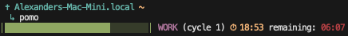

# pomo

A terminal Pomodoro timer written in Swift.

## Features

- Customizable work/break durations
- Multiple work cycles with break intervals
- Runs inside [herdr](https://github.com/ogilvieherdr/herdr) with notification support
- Falls back to terminal bell when not in herdr
- ANSI-colored countdown display



## Usage

```bash
# Default 25-minute work session
pomo

# Custom duration (minutes)
pomo -d 15

# Multiple work cycles with breaks
pomo -c 3 -b 3
```

## Building

```bash
swift build -c release
```

## Testing

```bash
swift test
```
